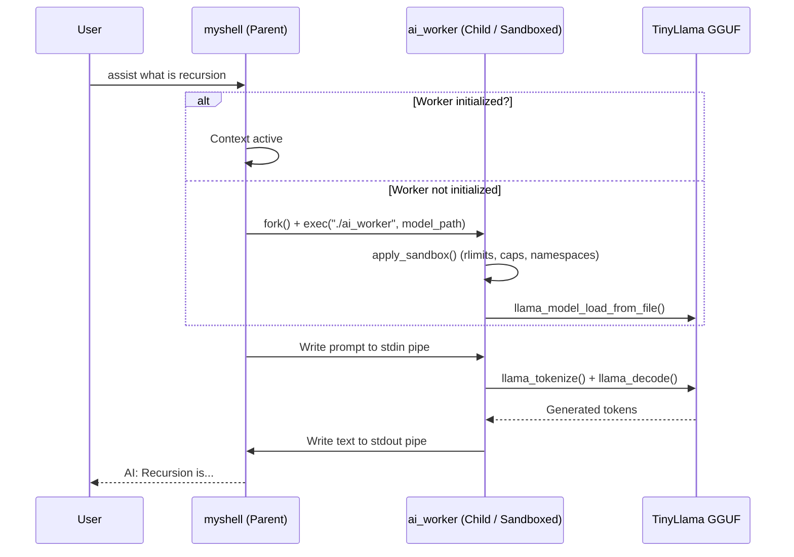

# 🧠 Complete Project Context: Offline AI Assistant Shell (`mini-shell`)

> **Context Document Purpose:** Single-file consolidated repository context for LLM ingestion, code analysis, debugging, and feature development.
> **Repository:** `offline-shell-assistant` / `mini-shell`  
> **Tech Stack:** C (C11), CMake, Make, `llama.cpp`, Linux Syscalls (`fork`, `pipe`, `dup2`, `execl`, `select`), Linux Security (`seccomp`, `rlimit`, `namespaces`, `libcap`).

---

## 📑 Table of Contents

1. [System Overview & Architecture](#1-system-overview--architecture)
2. [Directory Tree](#2-directory-tree)
3. [C Source Files & Headers](#3-c-source-files--headers)
   - [`mini-shell/shell.h`](#mini-shellshellh)
   - [`mini-shell/main.c`](#mini-shellmainc)
   - [`mini-shell/shell.c`](#mini-shellshellc)
   - [`mini-shell/ai_worker.c`](#mini-shellai_workerc)
   - [`mini-shell/sandbox.c`](#mini-shellsandboxc)
   - [`mini-shell/seccomp_filter.c`](#mini-shellseccomp_filterc)
4. [Build Configuration Files](#4-build-configuration-files)
   - [`mini-shell/CMakeLists.txt`](#mini-shellcmakelists-txt)
   - [`mini-shell/Makefile`](#mini-shellmakefile)
5. [Test & Automation Scripts](#5-test--automation-scripts)
   - [`mini-shell/test_assist.sh`](#mini-shelltest_assistsh)
   - [`mini-shell/verify_model.sh`](#mini-shellverify_modelsh)
   - [`mini-shell/stress_test.sh`](#mini-shellstress_testsh)
6. [Documentation & Project Notes](#6-documentation--project-notes)
   - [`README.md` (Root)](#readmemd-root)
   - [`mini-shell/QUICKSTART.md`](#mini-shellquickstartmd)
   - [`mini-shell/README2.md`](#mini-shellreadme2md)
   - [`mini-shell/mistake.txt`](#mini-shellmistaketxt)
7. [Technical Audit Summary & Current Known Issues](#7-technical-audit-summary--current-known-issues)

---

## 1. System Overview & Architecture

The **Offline AI Assistant Shell** is a lightweight system shell written in C that integrates local LLM inference directly into the command-line interface.

### Process Isolation & IPC Model
- **`myshell` (Parent Process):** Interactive shell CLI loop parsing commands (`assist`, `assist-reset`, `help`, `clear`, `exit`, or standard Linux executables).
- **`ai_worker` (Child Process):** Sandboxed binary spawned via `fork()` and `execl()`. Communicates with `myshell` via two unidirectional anonymous Unix pipes (`pipe_to_worker` and `pipe_from_worker`).
- **Inference Engine:** Links against `llama.cpp` static library to load GGUF models (e.g., `TinyLlama-1.1B-Chat`) without external network access or daemon dependencies.



---

## 2. Directory Tree

```text
offline-shell-assistant/
├── README.md                 # Primary project README
└── mini-shell/               # Main application source directory
    ├── CMakeLists.txt        # CMake build configuration
    ├── Makefile              # Makefile fallback configuration
    ├── QUICKSTART.md         # Quickstart guide
    ├── README2.md            # Secondary documentation
    ├── ai_worker.c           # Sandboxed AI worker & llama.cpp wrapper
    ├── main.c                # Shell entry point
    ├── mistake.txt           # Developer note
    ├── sandbox.c             # Sandboxing & resource limit logic
    ├── seccomp_filter.c      # BPF Seccomp filter definition
    ├── shell.c               # Shell loop, parsing, process management & IPC
    ├── shell.h               # Core structures, headers, and constants
    ├── stress_test.sh        # Stress and load testing script
    ├── test_assist.sh        # Functional testing script
    └── verify_model.sh       # Model hash & integrity verification script
```

---

## 3. C Source Files & Headers

### `mini-shell/shell.h`
```c
#ifndef SHELL_H
#define SHELL_H

#include <stdbool.h>
#include <sys/types.h>

// Original shell functions
void shell_loop();
char *read_line();
char **split_line(char *line);
int execute(char **args);

// AI assistant functions
#define AI_PROMPT_MAX 4096
#define AI_RESPONSE_MAX 16384
#define AI_TIMEOUT_SEC 30
#define AI_WORKER_PATH "./ai_worker"
#define AI_MODEL_PATH_ENV "HOME"

typedef struct {
    pid_t worker_pid;
    int pipe_to_worker[2];
    int pipe_from_worker[2];
    bool is_initialized;
} ai_context_t;

int init_ai_context(ai_context_t *ctx);
void cleanup_ai_context(ai_context_t *ctx);
int handle_assist_command(ai_context_t *ctx, const char *prompt);

#endif
```

---

### `mini-shell/main.c`
```c
#include <stdio.h>
#include "shell.h"

int main() {
    shell_loop();  // Start the shell
    return 0;
}
```

---

### `mini-shell/shell.c`
```c
#include <stdio.h>
#include <stdlib.h>
#include <string.h>
#include <unistd.h>
#include <sys/wait.h>
#include <sys/select.h>
#include <signal.h>
#include <errno.h>
#include "shell.h"

#define MAX_LINE 1024
#define MAX_ARGS 64
#define DELIM " \t\r\n\a"

// Global AI context
static ai_context_t g_ai_ctx = {0};

void shell_loop() {
    char *line;
    char **args;
    int status = 1;

    do {
        printf("mini-shell> ");
        line = read_line();
        args = split_line(line);
        status = execute(args);

        free(line);
        free(args);
    } while (status);
    
    // Cleanup on exit
    cleanup_ai_context(&g_ai_ctx);
}

char *read_line() {
    char *line = NULL;
    size_t bufsize = 0;
    getline(&line, &bufsize, stdin);
    return line;
}

char **split_line(char *line) {
    int bufsize = MAX_ARGS, position = 0;
    char **tokens = malloc(bufsize * sizeof(char*));
    char *token;

    token = strtok(line, DELIM);
    while (token != NULL) {
        tokens[position++] = token;
        token = strtok(NULL, DELIM);
    }
    tokens[position] = NULL;
    return tokens;
}

int execute(char **args) {
    if (args[0] == NULL) return 1;

    // Check for assist command
    if (strcmp(args[0], "assist") == 0) {
        if (args[1] == NULL) {
            fprintf(stderr, "Usage: assist <query>\n");
            return 1;
        }
        
        // Concatenate all arguments after "assist"
        char prompt[AI_PROMPT_MAX] = {0};
        int offset = 0;
        for (int i = 1; args[i] != NULL && offset < AI_PROMPT_MAX - 2; i++) {
            int len = snprintf(prompt + offset, AI_PROMPT_MAX - offset, "%s ", args[i]);
            if (len > 0) offset += len;
        }
        
        // Initialize AI context if needed
        if (!g_ai_ctx.is_initialized) {
            if (init_ai_context(&g_ai_ctx) != 0) {
                fprintf(stderr, "AI assistant unavailable\n");
                return 1;
            }
        }
        
        return handle_assist_command(&g_ai_ctx, prompt) == 0 ? 1 : 1;
    }
    
    // Check for assist-reset command
    if (strcmp(args[0], "assist-reset") == 0) {
        cleanup_ai_context(&g_ai_ctx);
        printf("AI assistant reset\n");
        return 1;
    }

    if (strcmp(args[0], "exit") == 0) return 0;
    if (strcmp(args[0], "clear") == 0) { system("clear"); return 1; }
    if (strcmp(args[0], "help") == 0) {
        printf("Mini Shell - Built-in Commands:\n");
        printf("  help          - Show this message\n");
        printf("  clear         - Clear the screen\n");
        printf("  assist <query> - Ask AI assistant\n");
        printf("  assist-reset  - Restart AI worker\n");
        printf("  exit          - Exit the shell\n");
        return 1;
    }
    
    pid_t pid = fork();
    if (pid == 0) {
        if (execvp(args[0], args) == -1)
            perror("mini-shell");
        exit(EXIT_FAILURE);
    } else if (pid < 0) {
        perror("mini-shell");
    } else {
        int status;
        waitpid(pid, &status, 0);
    }
    return 1;
}

// AI context management
int init_ai_context(ai_context_t *ctx) {
    // Build model path
    char model_path[512];
    const char *home = getenv("HOME");
    if (!home) home = "/tmp";
    snprintf(model_path, sizeof(model_path), "%s/.assist_ai/model.gguf", home);
    
    // Create pipes
    if (pipe(ctx->pipe_to_worker) == -1) {
        perror("pipe to worker");
        return -1;
    }
    
    if (pipe(ctx->pipe_from_worker) == -1) {
        perror("pipe from worker");
        close(ctx->pipe_to_worker[0]);
        close(ctx->pipe_to_worker[1]);
        return -1;
    }
    
    // Fork AI worker
    ctx->worker_pid = fork();
    
    if (ctx->worker_pid == -1) {
        perror("fork");
        close(ctx->pipe_to_worker[0]);
        close(ctx->pipe_to_worker[1]);
        close(ctx->pipe_from_worker[0]);
        close(ctx->pipe_from_worker[1]);
        return -1;
    }
    
    if (ctx->worker_pid == 0) {
        // Child process: AI worker
        
        // Redirect stdin/stdout to pipes
        dup2(ctx->pipe_to_worker[0], STDIN_FILENO);
        dup2(ctx->pipe_from_worker[1], STDOUT_FILENO);
        
        // Close unused pipe ends
        close(ctx->pipe_to_worker[0]);
        close(ctx->pipe_to_worker[1]);
        close(ctx->pipe_from_worker[0]);
        close(ctx->pipe_from_worker[1]);
        
        // Execute AI worker
        execl(AI_WORKER_PATH, "ai_worker", model_path, NULL);
        
        // If exec fails, try echo mode
        execl(AI_WORKER_PATH, "ai_worker", "--echo", NULL);
        
        // If still fails, exit
        perror("execl ai_worker");
        exit(EXIT_FAILURE);
    }
    
    // Parent: close unused pipe ends
    close(ctx->pipe_to_worker[0]);
    close(ctx->pipe_from_worker[1]);
    
    ctx->is_initialized = true;
    printf("AI assistant initialized (PID: %d)\n", ctx->worker_pid);
    
    return 0;
}

void cleanup_ai_context(ai_context_t *ctx) {
    if (!ctx->is_initialized) return;
    
    // Close pipes
    close(ctx->pipe_to_worker[1]);
    close(ctx->pipe_from_worker[0]);
    
    // Kill worker
    if (ctx->worker_pid > 0) {
        kill(ctx->worker_pid, SIGTERM);
        waitpid(ctx->worker_pid, NULL, 0);
    }
    
    ctx->is_initialized = false;
    ctx->worker_pid = 0;
}

int handle_assist_command(ai_context_t *ctx, const char *prompt) {
    char safe_prompt[AI_PROMPT_MAX];
    char response[AI_RESPONSE_MAX];
    
    // Sanitize prompt
    size_t prompt_len = strnlen(prompt, AI_PROMPT_MAX - 2);
    strncpy(safe_prompt, prompt, prompt_len);
    safe_prompt[prompt_len] = '\n';
    safe_prompt[prompt_len + 1] = '\0';
    
    // Send prompt to worker
    ssize_t written = write(ctx->pipe_to_worker[1], safe_prompt, prompt_len + 1);
    if (written == -1) {
        perror("write to AI worker");
        cleanup_ai_context(ctx);
        return -1;
    }
    
    // Wait for response with timeout
    fd_set readfds;
    struct timeval timeout = { .tv_sec = AI_TIMEOUT_SEC, .tv_usec = 0 };
    
    FD_ZERO(&readfds);
    FD_SET(ctx->pipe_from_worker[0], &readfds);
    
    int ready = select(ctx->pipe_from_worker[0] + 1, &readfds, NULL, NULL, &timeout);
    
    if (ready == -1) {
        perror("select");
        cleanup_ai_context(ctx);
        return -1;
    } else if (ready == 0) {
        fprintf(stderr, "AI worker timeout\n");
        cleanup_ai_context(ctx);
        return -1;
    }
    
    // Read response
    ssize_t bytes_read = read(ctx->pipe_from_worker[0], response, AI_RESPONSE_MAX - 1);
    
    if (bytes_read <= 0) {
        fprintf(stderr, "AI worker connection lost\n");
        cleanup_ai_context(ctx);
        return -1;
    }
    
    response[bytes_read] = '\0';
    
    // Display response
    printf("AI: %s", response);
    if (response[bytes_read - 1] != '\n') {
        printf("\n");
    }
    
    return 0;
}
```

---

### `mini-shell/ai_worker.c`
```c
#include <stdio.h>
#include <stdlib.h>
#include <string.h>
#include <unistd.h>
#include <stdbool.h>

#define MAX_PROMPT_LEN 4096
#define MAX_RESPONSE_LEN 16384

extern void apply_sandbox(void);

int echo_worker() {
    char prompt[MAX_PROMPT_LEN];
    
    while (fgets(prompt, MAX_PROMPT_LEN, stdin)) {
        prompt[strcspn(prompt, "\n")] = '\0';
        if (strlen(prompt) == 0) continue;
        
        printf("Echo: %s\n", prompt);
        fflush(stdout);
    }
    
    return 0;
}

#ifdef USE_LLAMA

#include "llama.h"

int llama_worker(const char *model_path) {
    apply_sandbox();
    
    llama_backend_init();
    
    struct llama_model_params model_params = llama_model_default_params();
    model_params.n_gpu_layers = 0;
    
    struct llama_model *model = llama_model_load_from_file(model_path, model_params);
    if (!model) {
        fprintf(stderr, "Failed to load model\n");
        return 1;
    }
    
    const struct llama_vocab *vocab = llama_model_get_vocab(model);
    
    // Create context ONCE and reuse it
    struct llama_context_params ctx_params = llama_context_default_params();
    ctx_params.n_ctx = 2048;  // Larger context to avoid overflow
    ctx_params.n_batch = 128;
    ctx_params.n_threads = 2;
    
    struct llama_context *ctx = llama_init_from_model(model, ctx_params);
    if (!ctx) {
        llama_model_free(model);
        fprintf(stderr, "Failed to create context\n");
        return 1;
    }
    
    char prompt[MAX_PROMPT_LEN];
    int total_tokens = 0;  // Track context usage
    
    while (fgets(prompt, MAX_PROMPT_LEN, stdin)) {
        prompt[strcspn(prompt, "\n")] = '\0';
        
        if (strlen(prompt) == 0) {
            printf("\n");
            fflush(stdout);
            continue;
        }
        
        // If context is getting full, just note it
        if (total_tokens > 1800) {
            fprintf(stderr, "Warning: context nearly full, responses may degrade\n");
        }
        
        // Create sampler for this query
        struct llama_sampler_chain_params sampler_params = llama_sampler_chain_default_params();
        struct llama_sampler *sampler = llama_sampler_chain_init(sampler_params);
        llama_sampler_chain_add(sampler, llama_sampler_init_greedy());
        
        // Tokenize
        int n_prompt_tokens = llama_tokenize(
            vocab, prompt, strlen(prompt), NULL, 0, true, false
        );
        
        if (n_prompt_tokens < 0) n_prompt_tokens = -n_prompt_tokens;
        
        llama_token *prompt_tokens = malloc(n_prompt_tokens * sizeof(llama_token));
        if (!prompt_tokens) {
            fprintf(stderr, "Failed to allocate tokens\n");
            printf("Error: memory allocation failed\n");
            fflush(stdout);
            llama_sampler_free(sampler);
            continue;
        }
        
        llama_tokenize(vocab, prompt, strlen(prompt), prompt_tokens, n_prompt_tokens, true, false);
        
        // Create batch
        struct llama_batch batch = llama_batch_get_one(prompt_tokens, n_prompt_tokens);
        
        // Evaluate
        if (llama_decode(ctx, batch) != 0) {
            fprintf(stderr, "Decode failed\n");
            free(prompt_tokens);
            printf("Error: inference failed\n");
            fflush(stdout);
            llama_sampler_free(sampler);
            continue;
        }
        
        total_tokens += n_prompt_tokens;
        
        // Generate response
        char response[MAX_RESPONSE_LEN] = {0};
        int response_len = 0;
        int n_generated = 0;
        
        while (n_generated < 100) {  // Shorter responses
            llama_token new_token_id = llama_sampler_sample(sampler, ctx, -1);
            
            if (llama_vocab_is_eog(vocab, new_token_id)) break;
            
            char token_buf[16];
            int token_len = llama_token_to_piece(vocab, new_token_id, token_buf, sizeof(token_buf), 0, false);
            
            if (token_len > 0 && response_len + token_len < MAX_RESPONSE_LEN - 1) {
                memcpy(response + response_len, token_buf, token_len);
                response_len += token_len;
            }
            
            llama_token next_tokens[1] = {new_token_id};
            batch = llama_batch_get_one(next_tokens, 1);
            
            if (llama_decode(ctx, batch) != 0) {
                fprintf(stderr, "Decode failed during generation\n");
                break;
            }
            
            n_generated++;
        }
        
        total_tokens += n_generated;
        response[response_len] = '\0';
        
        // Output response
        printf("%s\n", response);
        fflush(stdout);
        
        // Cleanup
        free(prompt_tokens);
        llama_sampler_free(sampler);
    }
    
    // Final cleanup
    llama_free(ctx);
    llama_model_free(model);
    llama_backend_free();
    
    return 0;
}

#endif

int main(int argc, char **argv) {
    bool echo_mode = false;
    const char *model_path = NULL;
    
    for (int i = 1; i < argc; i++) {
        if (strcmp(argv[i], "--echo") == 0) {
            echo_mode = true;
        } else {
            model_path = argv[i];
        }
    }
    
    if (echo_mode) {
        apply_sandbox();
        return echo_worker();
    }
    
    if (model_path == NULL) {
        fprintf(stderr, "No model path provided, using echo mode\n");
        apply_sandbox();
        return echo_worker();
    }
    
    if (access(model_path, R_OK) != 0) {
        fprintf(stderr, "Model file not accessible, using echo mode\n");
        apply_sandbox();
        return echo_worker();
    }
    
#ifdef USE_LLAMA
    return llama_worker(model_path);
#else
    fprintf(stderr, "Compiled without llama.cpp support, using echo mode\n");
    apply_sandbox();
    return echo_worker();
#endif
}
```

---

### `mini-shell/sandbox.c`
```c
#define _GNU_SOURCE
#include <stdio.h>
#include <stdlib.h>
#include <unistd.h>
#include <sched.h>
#include <sys/resource.h>
#include <sys/prctl.h>
#include <sys/capability.h>
#include <errno.h>

extern void install_seccomp_filter(void);

void apply_sandbox(void) {
    // 1. Try to create new namespaces
    if (unshare(CLONE_NEWNS | CLONE_NEWPID) == -1) {
        if (errno == EPERM) {
            fprintf(stderr, "Warning: namespace isolation unavailable (EPERM)\n");
        }
    }
    
    // 2. Set resource limits
    struct rlimit mem_limit = { 
        .rlim_cur = 2UL * 1024 * 1024 * 1024,
        .rlim_max = 2UL * 1024 * 1024 * 1024 
    };
    setrlimit(RLIMIT_AS, &mem_limit);
    
    struct rlimit cpu_limit = { 
        .rlim_cur = 30,
        .rlim_max = 30 
    };
    setrlimit(RLIMIT_CPU, &cpu_limit);
    
    // 3. Disable core dumps
    struct rlimit core_limit = { .rlim_cur = 0, .rlim_max = 0 };
    setrlimit(RLIMIT_CORE, &core_limit);
    
    // 4. Close all file descriptors except stdin/stdout/stderr
    for (int fd = 3; fd < 256; fd++) {
        close(fd);
    }
    
    // 5. Drop capabilities
    #ifdef HAVE_LIBCAP
    cap_t caps = cap_init();
    if (caps) {
        cap_set_proc(caps);
        cap_free(caps);
    }
    #endif
    
    // 6. TEMPORARILY DISABLE SECCOMP FOR TESTING
    // TODO: Add more syscalls to whitelist once we identify which ones are needed
    // install_seccomp_filter();
    
    fprintf(stderr, "Sandbox applied (seccomp disabled for testing)\n");
}
```

---

### `mini-shell/seccomp_filter.c`
```c
#include <stdio.h>
#include <stddef.h>
#include <stdlib.h>
#include <errno.h>
#include <unistd.h>
#include <sys/prctl.h>
#include <linux/seccomp.h>
#include <linux/filter.h>
#include <linux/audit.h>
#include <sys/syscall.h>

// Seccomp whitelist for AI worker
void install_seccomp_filter(void) {
    struct sock_filter filter[] = {
        // Load architecture
        BPF_STMT(BPF_LD | BPF_W | BPF_ABS, offsetof(struct seccomp_data, arch)),
        // Check architecture is x86_64
        BPF_JUMP(BPF_JMP | BPF_JEQ | BPF_K, AUDIT_ARCH_X86_64, 1, 0),
        BPF_STMT(BPF_RET | BPF_K, SECCOMP_RET_KILL),
        
        // Load syscall number
        BPF_STMT(BPF_LD | BPF_W | BPF_ABS, offsetof(struct seccomp_data, nr)),
        
        // Whitelist essential syscalls
        BPF_JUMP(BPF_JMP | BPF_JEQ | BPF_K, __NR_read, 0, 1),
        BPF_STMT(BPF_RET | BPF_K, SECCOMP_RET_ALLOW),
        
        BPF_JUMP(BPF_JMP | BPF_JEQ | BPF_K, __NR_write, 0, 1),
        BPF_STMT(BPF_RET | BPF_K, SECCOMP_RET_ALLOW),
        
        BPF_JUMP(BPF_JMP | BPF_JEQ | BPF_K, __NR_mmap, 0, 1),
        BPF_STMT(BPF_RET | BPF_K, SECCOMP_RET_ALLOW),
        
        BPF_JUMP(BPF_JMP | BPF_JEQ | BPF_K, __NR_munmap, 0, 1),
        BPF_STMT(BPF_RET | BPF_K, SECCOMP_RET_ALLOW),
        
        BPF_JUMP(BPF_JMP | BPF_JEQ | BPF_K, __NR_brk, 0, 1),
        BPF_STMT(BPF_RET | BPF_K, SECCOMP_RET_ALLOW),
        
        BPF_JUMP(BPF_JMP | BPF_JEQ | BPF_K, __NR_exit_group, 0, 1),
        BPF_STMT(BPF_RET | BPF_K, SECCOMP_RET_ALLOW),
        
        BPF_JUMP(BPF_JMP | BPF_JEQ | BPF_K, __NR_exit, 0, 1),
        BPF_STMT(BPF_RET | BPF_K, SECCOMP_RET_ALLOW),
        
        BPF_JUMP(BPF_JMP | BPF_JEQ | BPF_K, __NR_rt_sigreturn, 0, 1),
        BPF_STMT(BPF_RET | BPF_K, SECCOMP_RET_ALLOW),
        
        BPF_JUMP(BPF_JMP | BPF_JEQ | BPF_K, __NR_futex, 0, 1),
        BPF_STMT(BPF_RET | BPF_K, SECCOMP_RET_ALLOW),
        
        BPF_JUMP(BPF_JMP | BPF_JEQ | BPF_K, __NR_getpid, 0, 1),
        BPF_STMT(BPF_RET | BPF_K, SECCOMP_RET_ALLOW),
        
        BPF_JUMP(BPF_JMP | BPF_JEQ | BPF_K, __NR_fstat, 0, 1),
        BPF_STMT(BPF_RET | BPF_K, SECCOMP_RET_ALLOW),
        
        BPF_JUMP(BPF_JMP | BPF_JEQ | BPF_K, __NR_lseek, 0, 1),
        BPF_STMT(BPF_RET | BPF_K, SECCOMP_RET_ALLOW),
        
        BPF_JUMP(BPF_JMP | BPF_JEQ | BPF_K, __NR_close, 0, 1),
        BPF_STMT(BPF_RET | BPF_K, SECCOMP_RET_ALLOW),
        
        BPF_JUMP(BPF_JMP | BPF_JEQ | BPF_K, __NR_madvise, 0, 1),
        BPF_STMT(BPF_RET | BPF_K, SECCOMP_RET_ALLOW),
        
        BPF_JUMP(BPF_JMP | BPF_JEQ | BPF_K, __NR_openat, 0, 1),
        BPF_STMT(BPF_RET | BPF_K, SECCOMP_RET_ALLOW),
        
        // Default: kill process
        BPF_STMT(BPF_RET | BPF_K, SECCOMP_RET_KILL)
    };
    
    struct sock_fprog prog = {
        .len = (unsigned short)(sizeof(filter) / sizeof(filter[0])),
        .filter = filter,
    };
    
    // Enable seccomp
    if (prctl(PR_SET_NO_NEW_PRIVS, 1, 0, 0, 0) == -1) {
        perror("prctl NO_NEW_PRIVS");
        exit(1);
    }
    
    if (prctl(PR_SET_SECCOMP, SECCOMP_MODE_FILTER, &prog) == -1) {
        perror("prctl SECCOMP");
        exit(1);
    }
}
```

---

## 4. Build Configuration Files

### `mini-shell/CMakeLists.txt`
```cmake
cmake_minimum_required(VERSION 3.10)
project(OfflineAssistShell C CXX)

# Basic Compilation Settings
set(CMAKE_C_STANDARD 11)
set(CMAKE_CXX_STANDARD 14)
set(CMAKE_C_FLAGS "${CMAKE_C_FLAGS} -Wall -Wextra -fstack-protector-strong")
set(CMAKE_CXX_FLAGS "${CMAKE_CXX_FLAGS} -Wall -Wextra -fstack-protector-strong")

# Shell executable
add_executable(myshell main.c shell.c)

# --- LLAMA.CPP INTEGRATION ---
# 1. Include llama.cpp as a subdirectory (Recommended for static linking)
# This assumes the 'llama.cpp' directory is a sibling to 'build' or in the root.
add_subdirectory(llama.cpp)

# 2. AI worker executable
add_executable(ai_worker ai_worker.c sandbox.c seccomp_filter.c)

# Check if the 'llama' target was successfully added (meaning the project was found)
if(TARGET llama)
    target_compile_definitions(ai_worker PRIVATE USE_LLAMA)

    # Link directly against the targets defined by llama.cpp's CMake
    # The 'llama' target automatically brings in the 'ggml' targets and necessary includes.
    target_link_libraries(ai_worker
        PRIVATE
            llama
            ${CMAKE_THREAD_LIBS_INIT} # Use CMake's standard way to find pthread
            m
            dl
            stdc++
    )

    message(STATUS "✓✓✓ Building WITH llama.cpp support (using CMake targets) ✓✓✓")
else()
    message(WARNING "Building without llama.cpp (echo mode only). Check if llama.cpp exists.")
endif()

# --- OPTIONAL DEPENDENCIES ---
# libcap
find_library(CAP_LIB cap)
if(CAP_LIB)
    target_link_libraries(ai_worker PRIVATE ${CAP_LIB})
    target_compile_definitions(ai_worker PRIVATE HAVE_LIBCAP)
endif()

# --- INSTALLATION ---
install(TARGETS myshell ai_worker DESTINATION bin)
```

---

### `mini-shell/Makefile`
```make
CC = gcc
CFLAGS = -Wall

all: mini-shell

mini-shell: main.o shell.o
	$(CC) $(CFLAGS) -o mini-shell main.o shell.o

main.o: main.c shell.h
	$(CC) $(CFLAGS) -c main.c

shell.o: shell.c shell.h
	$(CC) $(CFLAGS) -c shell.c

clean:
	rm -f *.o mini-shell
```

---

## 5. Test & Automation Scripts

### `mini-shell/test_assist.sh`
```bash
#!/bin/bash

echo "=== Offline AI Assistant Test Suite ==="

BUILD_DIR="./build"
SHELL_BIN="$BUILD_DIR/myshell"

if [ ! -f "$SHELL_BIN" ]; then
    echo "Error: Shell binary not found"
    exit 1
fi

# Test 1: Basic functionality
echo "Test 1: Basic assist command"
echo -e "assist hello\nexit" | $SHELL_BIN | grep -q "AI:"
if [ $? -eq 0 ]; then
    echo "✓ PASS"
else
    echo "✗ FAIL"
fi

# Test 2: Empty prompt
echo "Test 2: Empty prompt handling"
echo -e "assist\nexit" | $SHELL_BIN 2>&1 | grep -q "Usage:"
if [ $? -eq 0 ]; then
    echo "✓ PASS"
else
    echo "✗ FAIL"
fi

# Test 3: Long prompt (near limit)
echo "Test 3: Long prompt"
LONG_PROMPT=$(python3 -c "print('word ' * 500)")
echo -e "assist $LONG_PROMPT\nexit" | timeout 35 $SHELL_BIN > /dev/null
if [ $? -eq 0 ] || [ $? -eq 124 ]; then
    echo "✓ PASS (handled without crash)"
else
    echo "✗ FAIL"
fi

# Test 4: Worker reset
echo "Test 4: Worker reset"
echo -e "assist test1\nassist-reset\nassist test2\nexit" | $SHELL_BIN | grep -c "AI:" | grep -q "2"
if [ $? -eq 0 ]; then
    echo "✓ PASS"
else
    echo "✗ FAIL"
fi

# Test 5: Multiple consecutive queries
echo "Test 5: Multiple queries"
echo -e "assist one\nassist two\nassist three\nexit" | $SHELL_BIN | grep -c "AI:" | grep -q "3"
if [ $? -eq 0 ]; then
    echo "✓ PASS"
else
    echo "✗ FAIL"
fi

# Test 6: Special characters
echo "Test 6: Special characters"
echo -e "assist what is 2+2?\nexit" | $SHELL_BIN | grep -q "AI:"
if [ $? -eq 0 ]; then
    echo "✓ PASS"
else
    echo "✗ FAIL"
fi

echo "=== Test Suite Complete ==="
```

---

### `mini-shell/verify_model.sh`
```bash
#!/bin/bash

MODEL_DIR="$HOME/.assist_ai"
MODEL_FILE="$MODEL_DIR/model.gguf"
CHECKSUM_FILE="$MODEL_DIR/model.md5"

echo "=== Model Integrity Verification ==="

if [ ! -f "$MODEL_FILE" ]; then
    echo "✗ Model file not found at $MODEL_FILE"
    exit 1
fi

echo "Model file: $MODEL_FILE"
ls -lh "$MODEL_FILE"

if [ -f "$CHECKSUM_FILE" ]; then
    echo "Verifying checksum..."
    cd "$MODEL_DIR"
    md5sum -c model.md5
    if [ $? -eq 0 ]; then
        echo "✓ Checksum valid"
    else
        echo "✗ Checksum mismatch - possible tampering"
        exit 1
    fi
else
    echo "Creating checksum..."
    md5sum "$MODEL_FILE" > "$CHECKSUM_FILE"
    echo "✓ Checksum created"
fi

echo "=== Verification Complete ==="
```

---

### `mini-shell/stress_test.sh`
```bash
#!/bin/bash

BUILD_DIR="./build"
SHELL_BIN="$BUILD_DIR/myshell"

echo "=== Stress Test ==="

# Test 1: Rapid queries
echo "Test 1: 10 rapid queries"
(
for i in {1..10}; do
    echo "assist query $i"
done
echo "exit"
) | timeout 60 $SHELL_BIN > /tmp/stress_output.txt 2>&1

RESPONSES=$(grep -c "AI:" /tmp/stress_output.txt)
echo "Received $RESPONSES responses"

if [ $RESPONSES -ge 8 ]; then
    echo "✓ PASS (at least 80% success rate)"
else
    echo "✗ FAIL (too many failures)"
fi

# Test 2: Worker crash recovery
echo "Test 2: Worker crash recovery"
$SHELL_BIN &
SHELL_PID=$!
sleep 2

echo "assist test1" > /proc/$SHELL_PID/fd/0
sleep 2

WORKER_PID=$(pgrep -P $SHELL_PID ai_worker)
if [ -n "$WORKER_PID" ]; then
    echo "Killing worker PID $WORKER_PID"
    kill -9 $WORKER_PID
    sleep 1
    
    echo "assist test2" > /proc/$SHELL_PID/fd/0
    sleep 2
    
    NEW_WORKER_PID=$(pgrep -P $SHELL_PID ai_worker)
    if [ -n "$NEW_WORKER_PID" ] && [ "$NEW_WORKER_PID" != "$WORKER_PID" ]; then
        echo "✓ PASS (worker respawned)"
    else
        echo "✗ FAIL (worker did not respawn)"
    fi
fi

kill $SHELL_PID 2>/dev/null

# Test 3: Memory leak check
echo "Test 3: Memory leak check"
valgrind --leak-check=full --error-exitcode=1 \
    $SHELL_BIN < <(echo -e "assist test\nexit") > /dev/null 2>&1

if [ $? -eq 0 ]; then
    echo "✓ PASS (no memory leaks detected)"
else
    echo "⚠ WARNING (potential memory leaks - review valgrind output)"
fi

echo "=== Stress Test Complete ==="
```

---

## 6. Documentation & Project Notes

### `README.md` (Root)
```markdown
# 🧠 Offline AI Assistant Shell: Secure Local LLM Integration
> A **secure, offline AI assistant** integrated directly into a custom C shell — powered by [`llama.cpp`](https://github.com/ggerganov/llama.cpp) for local inference.

---

## 🌱 Project Story  

Around six months ago — I began working on something similar to the Gemini CLI agent but with a different philosophy.  

After switching to **Kali Linux**, I found even simple tasks challenging at first. Like most developers, I often relied on ChatGPT or online resources for help. Then a thought struck me:  

> “If AI assistants can guide us everywhere online, why can’t one live inside the terminal itself?”  

That question led me to explore how an AI model could safely assist users within a **command-line environment**. I quickly realized this came with serious risks — from **data corruption** and **privilege escalation** to **privacy breaches** and **system compromise**.  

Instead of abandoning the idea, I decided to design it **responsibly**, focusing on **security-first principles**:  
- Studying **AI agent behavior** inside operating systems  
- Implementing **sandboxing** and **syscall filtering (Seccomp)**  
- Ensuring **fully offline**, **local inference** for data privacy  

---
---

## 📺 Demo Video

Check out a quick demonstration of the offline AI assistant in action.

[](https://www.youtube.com/watch?v=nCAE7SovqPM)

---

## ⚙️ Tech Stack & Security Architecture  

| Component | Purpose |
|------------|----------|
| **C** | System-level shell implementation |
| **CMake** | Build automation |
| **llama.cpp** | Efficient local inference on CPU |
| **TinyLlama-1.1B-Chat** | Lightweight conversational LLM |
| **Seccomp (Secure Computing Mode)** | Syscall filtering and sandboxing |

This architecture ensures the assistant operates **entirely offline**, in a **restricted and isolated** environment — minimizing system exposure while preserving performance and privacy.

---

## 🧠 How It Works  

Once launched, the shell initializes a **sandboxed AI worker** that processes natural language queries locally.  

mini-shell> assist what is recursion
The assistant interprets your question, generates a conversational response, and displays it — without internet access or external APIs.
Every system call is filtered through Seccomp, preventing unsafe or unauthorized operations.

### 🔐 Security Design
Layer	Mechanism	Purpose   
Seccomp	Syscall whitelist	Restrict risky system operations   
Rlimits	Resource caps	Limit CPU & memory usage    
Namespaces	Process & FS isolation	Contain execution context   
Capability Dropping	Kernel privilege reduction	Prevent escalations   

These combined mechanisms ensure strong process isolation, privacy, and fail-safe execution.

⚡ Installation
🧩 Prerequisites
sudo apt-get install build-essential cmake libcap-dev valgrind  

1️⃣ Clone & Build llama.cpp

cd ~   
git clone https://github.com/ggerganov/llama.cpp.git  
cd llama.cpp  
rm -rf build && mkdir build && cd build  
cmake .. -DBUILD_SHARED_LIBS=OFF  
make llama -j$(nproc)  
  

2️⃣ Download Model

mkdir -p ~/.assist_ai  
cd ~/.assist_ai  
wget https://huggingface.co/TheBloke/TinyLlama-1.1B-Chat-v1.0-GGUF/resolve/main/tinyllama-1.1b-chat-v1.0.Q4_K_M.gguf -O model.gguf  
md5sum model.gguf > model.md5  


3️⃣ Build the Shell

cd ~/Documents/C_project/mini-shell    
mkdir build && cd build    
cmake ..    
make -j$(nproc)    


💡 Usage
Action	Command  
Run shell	./myshell  
Ask the AI assistant	mini-shell> assist what is recursion 
Reset the AI worker	mini-shell> assist-reset  
Exit the shell	mini-shell> exit  


🧪 Testing  

| Test	| Command	 | Purpose | 
|------------|----------|------------|
| Run test suite	| ./test_assist.sh	| Functional testing |  
| Verify model integrity	| ./verify_model.sh	| MD5 hash check |  
| Stress test |	./stress_test.sh |	Load/stability validation  |
| Security audit	| strace -f ./myshell	| Syscall inspection  |

⚠️ Troubleshooting
| Problem	| Possible Cause | Solution |
|------------|----------|--------------|
| Worker fails to start	|                             Missing model file	        |                  Ensure ~/.assist_ai/model.gguf exists |
| Timeout errors	        |                           Context too large	             |             Reduce n_ctx or use smaller model |
| Namespace errors	       |                          Kernel limitations	            |              Fallback disables isolation |
| Seccomp kills worker	   |                          Blocked syscall	                |            Update seccomp_filter.c whitelist |


📊 Performance (CPU-Only)
| Metric | Value | Notes |
|------------|----------|--------------|
| First query | ~2–3 s | Includes model load time |
| Subsequent queries | ~1–2 s | Reuses context |
| Memory usage | ~1–1.5 GB | Depends on model |
| Token speed |10–20 tokens/s | CPU-dependent |


🧩 Future Scope
This project represents an early exploration into secure, agentic AI at the system level.
In the next phase, I aim to:

🔁 Fine-tune the AI assistant for contextual awareness and adaptive command guidance  
🧠 Transform the shell into an agentic CLI, capable of decision-making within secure bounds  
🧩 Collaborate with mentors or security experts to enhance kernel-level safety and inference reliability  
🔒 Explore reinforcement-based task execution within isolated sandboxes  

I believe the fusion of Machine Learning and Cybersecurity can define the next generation of secure AI agents, and this project is my step toward that direction.

🛡️ Design Philosophy
“Local intelligence should be private, safe, and performant.”  
This shell demonstrates how AI inference can be embedded directly into system utilities while preserving offline privacy and integrity — valuable for embedded, defense, and research systems.  


📜 License
Licensed under the MIT License — see the LICENSE file for details.  

🤝 Contributing  
Contributions and security improvements are welcome!  
Please open an issue before submitting major changes.  

🙏 Acknowledgments  
llama.cpp — Local LLM engine  
TheBloke — Model provider    
Research inspirations from secure AI sandboxing and trusted computing  

<p align="center"><sub>🧠 Built for privacy. Designed for performance. Secured by sandboxing.</sub></p> 
```

---

### `mini-shell/QUICKSTART.md`
```markdown
# Quick Start Guide

## Setup

# Download and extract
cd ~/your-shell-project/build
./myshell

# Try it
mini-shell> assist hello world
AI: Echo: hello world

mini-shell> exit
If Model Available
Verify model
ls -lh ~/.assist_ai/model.gguf

# Should see ~600MB file

# Run with inference
./myshell
mini-shell> assist explain AI in one sentence
AI: [AI-generated response]
Test Commands
bash# Basic query
assist what is 2 plus 2

# Multi-word prompt
assist explain the difference between RAM and ROM

# Reset if worker hangs
assist-reset

# Exit shell
exit
```

---

### `mini-shell/README2.md`
```markdown
## ✨ Overview

The **Offline AI Assistant Shell** is a C-based shell environment enhanced with an integrated **local AI assistant**.  
It runs **entirely offline**, ensuring **data privacy**, **sandboxed execution**, and **system-level security**.

---

## ⚙️ Features

 **Offline Operation** — No internet, no APIs, full privacy.  
 **Secure Sandboxing** — Multiple layers of protection for safe inference.  
 **Graceful Fallback** — Reverts to echo mode if the model is missing.  
 **Timeout Protection** — Automatically terminates slow AI tasks.  
 **Reset Command** — Restart the AI worker safely anytime.  

---

## 🔐 Security Architecture

The assistant is **architected for isolation** — separating the trusted shell process from the sandboxed AI worker.

| Component | Role | Isolation Mechanisms |
|------------|------|----------------------|
| **Shell Process (`myshell`)** | Trusted interface. Handles parsing, I/O, and AI worker management. | — |
| **AI Worker (`ai_worker`)** | Sandboxed process for model inference. | `Seccomp`, `Rlimits`, `Namespaces`, Capability Dropping |

graph TD
    A[Shell Process (Trusted)] -->|fork() + Pipes| B(AI Worker - Sandboxed)
    B --> C[Load Model (Read-Only)]
    B --> D[Apply Seccomp Filter]
    B --> E[Drop Capabilities]
    B --> F[Set Resource Limits]

Isolation Layers
Seccomp (syscall whitelist) — Only necessary system calls allowed.
Rlimits — Caps RAM (~2 GB) and CPU time (30 s).
Namespaces — File system and PID isolation when supported.
Capability Dropping — Removes unnecessary kernel privileges.

##  Installation

### Prerequisites

### Install required dependencies:

sudo apt-get install build-essential cmake libcap-dev valgrind

### 1️⃣ Clone & Build llama.cpp

cd ~  
git clone https://github.com/ggerganov/llama.cpp.git  
cd llama.cpp  
rm -rf build && mkdir build && cd build  
cmake .. -DBUILD_SHARED_LIBS=OFF  
make llama -j$(nproc)  


### 2️⃣ Download Model

mkdir -p ~/.assist_ai  
cd ~/.assist_ai  
wget https://huggingface.co/TheBloke/TinyLlama-1.1B-Chat-v1.0-GGUF/resolve/main/tinyllama-1.1b-chat-v1.0.Q4_K_M.gguf -O model.gguf  
md5sum model.gguf > model.md5  

### 3️⃣ Build the Shell Project

cd ~/Documents/C_project/mini-shell  
mkdir build && cd build  
cmake ..  
make -j$(nproc)  

### 💡 Usage
Run the compiled shell executable:  
./myshell  
Action	Command  
Ask the AI assistant	mini-shell> assist what is recursion  
Reset the AI worker	mini-shell> assist-reset  
Exit the shell	mini-shell> exit  

### 🧪 Testing
Test	Command	Description  
Run test suite	./test_assist.sh	Automated functional testing  
Verify model integrity	./verify_model.sh	Confirms MD5 hash  
Stress test	./stress_test.sh	Load and stability testing  
Security audit	strace -f ./myshell	Check Seccomp syscall filtering  

### ⚠️ Troubleshooting
Problem	Possible Cause Solution  
Worker fails to start	Missing model file Ensure ~/.assist_ai/model.gguf exists  
Timeout errors	Context too large	Reduce n_ctx or use a smaller model  
Namespace errors	Unsupported kernel feature	Shell auto-fallback will disable isolation  
Seccomp kills worker	Missing allowed syscall	Update whitelist in seccomp_filter.c  

### 📊 Performance (CPU-Only)
Metric	Value	Notes  
First query time	~2–3 s	Includes model loading  
Subsequent queries	~1–2 s	Reuses context  
Memory usage	~1–1.5 GB	Depends on model size  
Token generation	10–20 tokens/s	CPU-dependent  

### 🛡️ Design Philosophy
“Local intelligence should be private, safe, and performant.”  
This project shows how AI inference can be embedded directly into system-level utilities while maintaining offline operation and secure sandboxing — suitable for embedded, defense, and research systems.  

### 📜 License
This project is licensed under the MIT License.  
See the LICENSE file for details.  

### 🤝 Contributing
Pull requests and security improvements are welcome!  
Please open an issue before submitting major changes.  

### Acknowledgments
llama.cpp — Local LLM inference engine  
TheBloke — Model provider  
Inspired by research in secure AI sandboxing and trusted computing  

<p align="center"> <sub>🧠 Built for privacy. Designed for performance. Secured by sandboxing.</sub> </p>
```

---

### `mini-shell/mistake.txt`
```text
Guys, i had commited a great mistake and that is i deleted everything in my project directory. DO NOT DO THIS MISTAKE. I REPEAT DO NOT USE rm -rf * IN YOUR PROJECT ROOT DIRECTORY. :) REGRETTING THE MISTAKE.
```

---

## 7. Technical Audit Summary & Current Known Issues

1. **Seccomp Syscall Filter Disabled:**
   - In `sandbox.c`, `install_seccomp_filter()` is currently commented out. To activate syscall filtering, `install_seccomp_filter()` must be invoked, and additional syscalls required by `llama.cpp` (`openat`, `sysinfo`, `futex`, `madvise`, etc.) must be added to `seccomp_filter.c`.
2. **CMake Build Target Conflict:**
   - `CMakeLists.txt` references `add_subdirectory(llama.cpp)`. The directory `mini-shell/llama.cpp` is currently empty. Either populate it as a Git submodule or update `CMakeLists.txt` to find `llama.cpp` from external paths.
3. **Makefile Scope Limitation:**
   - The current `Makefile` only compiles `mini-shell` (`main.c` and `shell.c`). It does not compile `ai_worker` (`ai_worker.c`, `sandbox.c`, `seccomp_filter.c`).
4. **Worker Relative Path Resolution:**
   - `shell.h` hardcodes `#define AI_WORKER_PATH "./ai_worker"`. Running `myshell` from a directory other than the location of the `ai_worker` binary causes `execl()` to fail.
5. **Context Memory Accumulation:**
   - `ai_worker.c` reuses a single `llama_context` (`n_ctx = 2048`). After 1800+ tokens, context length is exceeded unless `assist-reset` is called.
